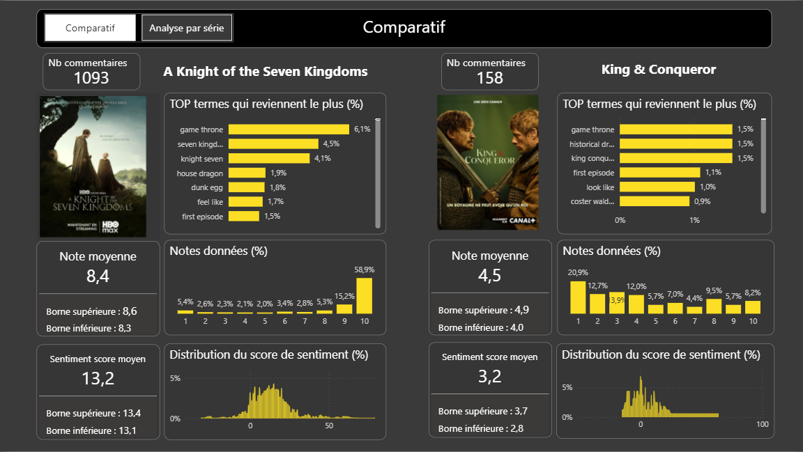
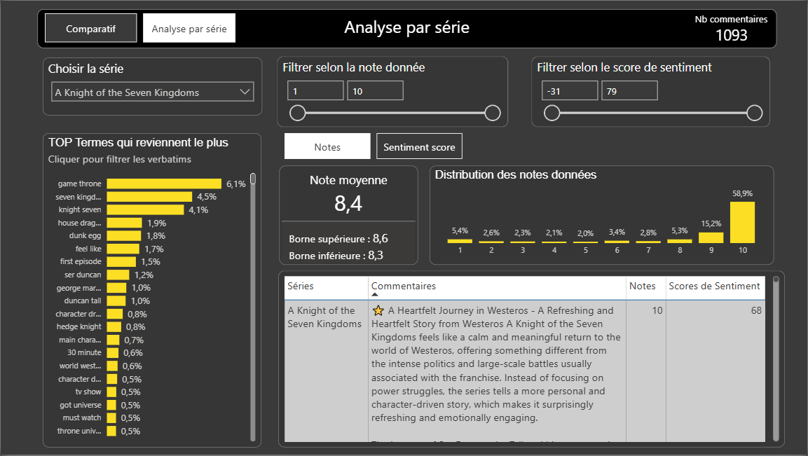
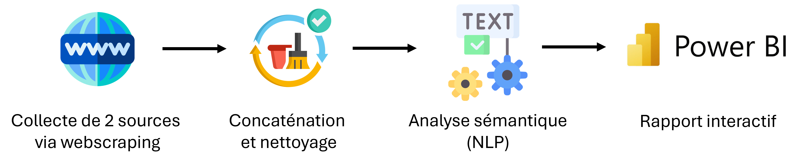

# 🏰 Séries médiévales : analyse comparative des notes et des avis

Pipeline de la collecte à la restitution : scraping d'Allociné et d'IMDb (BeautifulSoup, Selenium), transformations avec pandas, analyse sémantique des avis (NLTK, scikit-learn, AFINN), rapport interactif Power BI appliqué à la comparaison de deux séries médiévales. Environnement géré avec uv et git.

**Objectif métier : aider un décideur (ex : un producteur) à comprendre pourquoi une série plaît plus qu'une autre.**

Objectif personnel : développement continu de compétences techniques transférables à des environnements data professionnels.

Statut : projet en cours.

## Analyse
En bref : pour A Knight of the Seven Kingdoms, les avis positifs portent sur l’évolution des personnages, les négatifs sur les deux premiers épisodes et le format court. Pour King & Conqueror, la ressemblance avec Game of Thrones attire, mais la véracité historique est critiquée.

A Knight of the Seven Kingdoms (ma série préférée de 2026 !) :
- Moyenne : 8,4 / 10 - [8,3 - 8,6], n = 1 093
- Positif : l'évolution des personnages principaux 
- Négatif : les 2 premiers épisodes, la durée des épisodes (30 minutes), et un budget relativement faible pour une série de l'univers de Game of Thrones.
- Piste d'amélioration : continuer sur la lancée des derniers épisodes !

Nota Bene : il est probable que la série a été porté par un fort engouement : **60% des notes en février sur IMDb sont des 10**. Ce mois correspond à la sortie des épisodes 3, 4, 5 et 6. Une opération de notation n'est pas totalement à exclure non plus.

King & Conqueror :
- Moyenne : 4,5 / 10 - [4,0 - 4,9], n = 158
- Positif : similarité avec l'univers de Game of Thrones (notamment les acteurs)  
- Négatif : manque de véracité historique, en particulier le premier épisode
- Piste d'amélioration : se rapprocher davantage de la riche histoire de Guillaume le Conquérant

## Stack
Python · pandas · BeautifulSoup · Selenium · NLTK · scikit-learn · Power BI · uv · Git

## Pipeline

Le projet suit 5 grandes étapes :
1. **Collecte** : récupération des commentaires, notes, dates et métadonnées des deux séries sur Allociné et IMDb
2. **Concaténation et nettoyage** : harmonisation des notes, formats et identifiants
3. **Analyse exploratoire** : distributions des notes, différences entre les plateformes et enseignements statistiques
4. **Analyse sémantique** : prétraitement des commentaires, extraction des bigrams et pondération TF-IDF pour faire ressortir les top termes, score de sentiment grâce à la méthode AFINN
5. **Restitution** : modélisation des données et création d'un rapport Power BI interactif.

Concernant le NLP, le choix du couple TF-IDF - bigrams a été adopté pour privilégier l'interprétabilité et la simplicité pour préparer une future automatisation de la pipeline.

## Limites
- Seules les notes des spectateurs qui laissent un commentaire sont retenues, traduisant un engagement fort
- 84 % des avis viennent d'IMDb (notation plus généreuse qu'Allociné)
- Scraping d'IMDb n'est plus possible via Selenium aujourd'hui sans passer par la création d'un compte. Le notebook à ce sujet n'est donc pas reproductible.
- Les données récoltées sur Allociné et IMDb ne peuvent pas être partagées pour des raisons juridiques
- NLP sur les commentaires en anglais, car plus nombreux. Les commentaires d'Allociné sont donc exclus de l'analyse sémantique.

## Prochains développements : ma feuille de route
- [ ] BERTopic pour générer des thématiques
- [ ] Scripts Python à la place des notebooks
- [ ] Base SQL + dbt
- [ ] Pipeline hebdomadaire
- [ ] Récupération de 5 à 10 séries
- [ ] Sélection dynamique des deux séries à comparer
- [ ] Intégration à un environnement cloud

## Ma démarche avec l'IA : un mentor et pas un exécutant
- Pas de vibe coding
- Code générique adapté selon le contexte et la pertinence
- Pas de données injectées dans le LLM 
- Réflexion préalable à mes propres solutions

## Contact
Clément — Data Analyst... et passionné d'Histoire · [LinkedIn](https://www.linkedin.com/in/cl%C3%A9ment-fouchier-20206a152/)